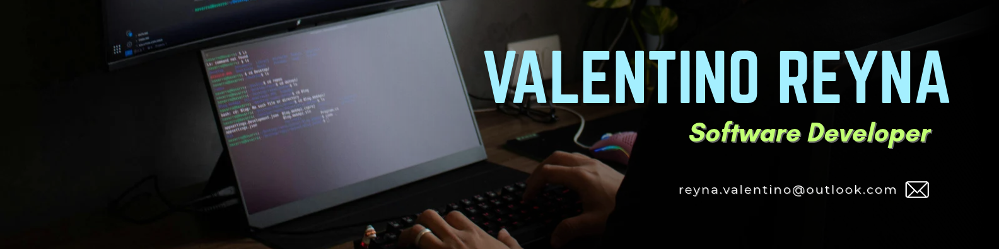

<h1 align="center">Hola 👋 soy Valentino Reyna</h1>

  

  
  

 

<h2>Sobre mí 😃</h2>

🎓 Estudiante del último año del <b>Técnico Superior en Desarrollo de Aplicaciones Multiplataforma (DAM)</b> en Planeta FP - UNIE (2026 - 2027). Titulación prevista: junio de 2027

💻 Desarrollador backend junior en formación, especializado en el ecosistema <b>Java</b>: <b>Spring Boot</b>, <b>JPA</b> y APIs REST sobre bases de datos relacionales (<b>MySQL</b>)

🟢 También creo APIs REST con <b>Node.js y Express</b>, con <b>MongoDB (Mongoose)</b> como base de datos no relacional

📱 Desarrollo de aplicaciones Android con <b>Kotlin</b>

🔧 Control de versiones con <b>Git y GitHub</b> y pruebas de endpoints con <b>Postman</b>

🔐 Prácticas profesionales de ciberseguridad en Atalanta (Linux, SSH, UFW, VirtualBox)

🔎 Busco mi primer puesto como <b>desarrollador Java backend</b>

📫 Contacto: <b>reyna.valentino@outlook.com</b>

 

<h2>Tecnologías 👨🏻‍💻</h2>

  

 

<h2>Idiomas 🌍</h2>

- 🇪🇸 Español (nativo)
- 🇬🇧 Inglés: B1 (certificado Cambridge)
 

<h2>Intereses 🎯</h2>

Desarrollo backend con Java · Spring Boot · APIs REST · Desarrollo de aplicaciones móviles
  
 
