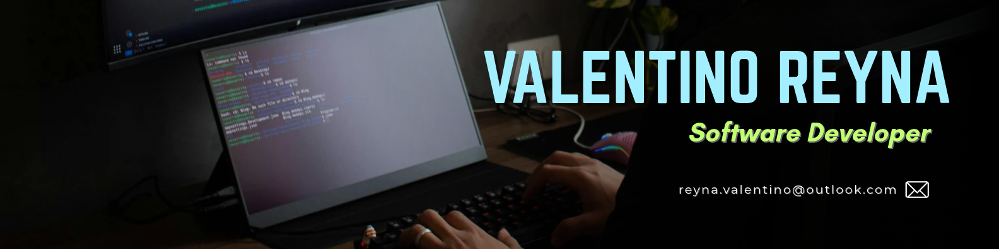

<h1 align="center">Hola 👋 soy Valentino Reyna ✨</h1>

  

  
  

 

<h2>Sobre mí 😃</h2>
<!--Intro start-->

🎓 <b>Técnico Superior en Desarrollo de Aplicaciones Multiplataforma (DAM)</b> en Planeta FP - UNIE (2026 - 2027)

💻 Desarrollador backend junior enfocado en <b>Java, Spring Boot y Kotlin</b>

🗄️ He participado en proyectos académicos con bases de datos <b>MySQL</b> y control de versiones con <b>Git</b>

🔐 Prácticas profesionales de ciberseguridad en Atalanta (Linux, SSH, UFW, VirtualBox)

🎯 Busco mi primer puesto como <b>desarrollador Java backend</b>

📫 Contacto: <b>reyna.valentino@outlook.com</b>

<!--Intro end-->
 

<h2>Tecnologías conocidas 👨🏻‍💻</h2>
<!--tech stack icons-->

  

 

<h2>Experiencia 💼</h2>

<b>Prácticas profesionales de ciberseguridad · Atalanta</b> <i>(Mayo - Junio 2025)</i>

- Creación y configuración de máquinas virtuales (VirtualBox) para entornos de prueba.
- Aplicación de medidas de seguridad (SSH, UFW) y gestión de usuarios en Linux (Ubuntu).
- Control y documentación de acceso al equipo en Windows.
 

<h2>Educación 🎓</h2>

<b>Técnico Superior en Desarrollo de Aplicaciones Multiplataforma</b> · Planeta FP - UNIE <i>(2026 - 2027)</i>

- Desarrollo backend con Java y Spring Boot.
- Desarrollo de aplicaciones Android con Kotlin.
- Uso de Git y GitHub para control de versiones.
- Gestión de bases de datos MySQL.

<b>Grado en Ingeniería del Software (estudios no finalizados)</b> · Universidad Politécnica de Madrid <i>(2025)</i>
  

<h2>Idiomas 🌍</h2>

- 🇪🇸 Español (nativo)
- 🇬🇧 Inglés: B1 (certificado Cambridge)
 

<h2>Intereses 🎯</h2>

Desarrollo backend con Java · Framework Spring · Inteligencia Artificial y Big Data · Desarrollo de aplicaciones móviles
  

<!--

<h2>Algunos proyectos 👨🏻‍💻</h2>

| Proyecto | Descripción | Tecnologías |
|---|---|---|
| [Nombre del proyecto 1](https://github.com/TU_USUARIO/REPOSITORIO) | Descripción breve de qué hace | Java, Spring Boot, MySQL |
| [Nombre del proyecto 2](https://github.com/TU_USUARIO/REPOSITORIO) | Descripción breve de qué hace | Kotlin, Android |

-->
 
